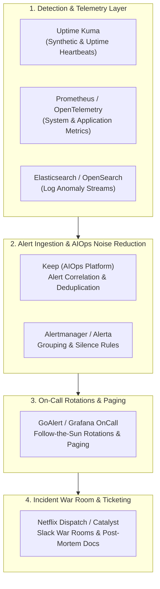

# 🚨 Awesome Incident Management

### 🛠️ Curated Directory of SaaS Platforms & Sovereign Open-Source Incident Response Ecosystem

  
  
  
  
  
  

**A battle-tested reference guide for Site Reliability Engineers (SREs), DevOps architects, System Administrators, and Engineering Leaders.**

*Track, triage, escalate, resolve, and analyze production incidents with minimum MTTR and zero alert fatigue.*

---

## 📑 Table of Contents

- [🔍 Overview & SEO Context](#-overview--seo-context)
- [📊 Sector Overview & Market Dynamics](#-sector-overview--market-dynamics)
- [🏢 SaaS & Enterprise Platforms](#-saas--enterprise-platforms)
- [🔓 Sovereign Open-Source Projects](#-sovereign-open-source-projects)
- [📐 Custom Incident Architecture Blueprint](#-custom-incident-architecture-blueprint)
- [🤝 How to Contribute](#-how-to-contribute)
- [📈 Star History](#-star-history)
- [💖 Support & Sponsoring](#-support--sponsoring)
- [⚖️ Disclaimer & License](#️-disclaimer--license)

---

## 🔍 Overview & SEO Context

**Incident Management** is the mission-critical operational lifecycle through which software and infrastructure engineering teams detect service anomalies, page designated on-call responders, coordinate resolution via war rooms and ChatOps, communicate live status to stakeholders, and conduct blameless post-mortems. 

Modern incident management platforms reduce **Mean Time to Acknowledge (MTTA)** and **Mean Time to Resolution (MTTR)** through:
- **Intelligent Alert Ingestion & Noise Reduction**: Deduplicating telemetry alerts from Prometheus, Datadog, Grafana, CloudWatch, and Sentry.
- **Dynamic On-Call Scheduling**: Managing follow-the-sun rotations, flexible shift overrides, and multi-tier escalation policies.
- **ChatOps & Collaborative War Rooms**: Provisioning automated Slack channels, Microsoft Teams rooms, Zoom bridges, and status page updates.
- **AIOps & Root-Cause Triage**: Correlating topological service maps, commit logs, and deploy metrics to pinpoint system bottlenecks.
- **Blameless Post-Mortems & Learning**: Documenting timelines, incident impact, action items, and SLO tracking to prevent recurrence.

> **Target Keywords:** *Incident Management, Incident Response, On-Call Scheduling, Alert Routing, PagerDuty Alternatives, Open Source On-Call, Opsgenie Migration, SRE Tools, DevOps Incident Response, MTTR Optimization, AIOps Alert Deduplication, Status Pages, Blameless Post-Mortem.*

---

## 📊 Sector Overview & Market Dynamics

The global **IT Incident Management and Emergency Incident Response Software Market** is currently valued at approximately **$7.2 Billion to $8.5 Billion**, projected to surpass **$15.5 Billion by 2032**, expanding at a Compound Annual Growth Rate (**CAGR**) of **10.1% to 11.4%**. 

From a market structure perspective, the sector is **moderately fragmented**:
- **Legacy ITSM Consolidators**: Mega-cap enterprises like **ServiceNow** and **Atlassian** control foundational enterprise ticketing, CMDB data, and enterprise-wide service catalogs.
- **Specialized Best-of-Breed SaaS**: Agile leaders such as **PagerDuty**, **Better Stack**, **incident.io**, and **Squadcast** dominate fast-moving engineering environments with developer-first ChatOps, real-time telephony paging, and deep observability integrations.
- **Sovereign Open-Source Wave**: Rapid emergence of production-grade self-hosted tools (like **Uptime Kuma**, **Keep**, **Netflix Dispatch**, and **GoAlert**) empowers privacy-conscious and budget-constrained organizations to eliminate per-seat licensing traps and retain full data sovereignty.

---

## 🏢 SaaS & Enterprise Platforms

The table below lists leading commercial SaaS incident response and on-call alerting solutions, **sorted in descending order by Company Size (Enterprise Valuation / ARR)**.

| 🏢 Platform / Vendor | 📈 Company Scale (Valuation / ARR) | 💵 Starting Tier Pricing | 🎁 Free Tier / Free Trial Limits | ⚡ Core Strengths & Key Capabilities |
| :--- | :--- | :--- | :--- | :--- |
| **[ServiceNow Incident Management](https://www.servicenow.com/)** | ~$200B+ Market Cap / ~$10.0B ARR (NYSE: NOW) | **$70.00 / fulfiller / month** (ITSM Foundation, annual agreement) | **15-Day Personal Developer Instance (PDI)** sandbox with full ITSM modules, or 30-day corporate evaluation (no perpetual free tier) | Enterprise ITIL standard; major incident response workbenches, dynamic CMDB sync, automated SLA tracking, and multi-department service catalog integration. |
| **[VictorOps / Splunk On-Call](https://www.splunk.com/en_us/products/on-call.html)** | ~$230B Parent Market Cap (Cisco) / Splunk acquired for **$28B** (~$4.2B ARR) | **$5.00 / user / month** (Starter plan, up to 10 seats, annual billing) | **14-Day Free Trial** with up to 10 users, unlimited alerting, and core monitoring integrations (no credit card required; no perpetual free tier) | Native integration with Splunk log analytics and observability; timeline-centric incident collaboration, bidirection alert routing, and custom escalations. |
| **[Jira Service Management](https://www.atlassian.com/software/jira/service-management)** | ~$45B+ Market Cap / ~$4.3B ARR (NASDAQ: TEAM) | **$20.00 / agent / month** (Standard plan, annual billing; $22.05 monthly) | **Free Forever for up to 3 agents**, unlimited customer portals, 2 GB file storage, 500 automation runs/month, and community support | Unified Atlassian ecosystem; embedded on-call scheduling, deep Jira issue linking, runbook attachments, and native Statuspage customer incident communication. |
| **[Opsgenie](https://www.atlassian.com/software/opsgenie)** | ~$45B+ Market Cap / ~$4.3B ARR (Atlassian unit; transitioning into JSM) | **$9.45 / user / month** (Essentials tier, annual billing; $11.55 monthly) | **Free Forever for up to 5 users**, 1 escalation policy, basic alert routing, and 100 international SMS notifications/month | Mature multi-team on-call rotation engine, flexible notification rules, and bi-directional ChatOps integrations for Slack and Microsoft Teams. |
| **[Freshservice](https://www.freshworks.com/freshservice/)** | ~$3.8B Market Cap / ~$680M ARR (NASDAQ: FRSH) | **$19.00 / agent / month** (Starter plan, annual billing; $29.00 monthly) | **14-Day Free Trial** with full Enterprise tier access, Freddy AI capabilities, asset mapping, and unlimited agents (no perpetual free tier) | Modern ITIL service management; Freddy AI alert clustering, automated on-call routing, incident war room creation, and dynamic asset dependency maps. |
| **[PagerDuty](https://www.pagerduty.com/)** | ~$1.8B Market Cap / ~$450M ARR (NYSE: PD) | **$21.00 / user / month** (Professional plan, annual billing; $25.00 monthly) | **Free Forever for up to 5 users**, 1 on-call schedule, 1 escalation policy, standard integrations, and 100 notification credits/month | Benchmark standard in SRE incident orchestration; reliable telephony paging, AI event intelligence (noise reduction), and real-time incident transcription. |
| **[Squadcast](https://www.squadcast.com/)** | ~$1.8B Parent Market Cap / ~$750M ARR (SolarWinds, NYSE: SWI) | **$9.00 / user / month** (Pro plan, annual billing; $12.00 monthly) | **Free Forever for up to 5 users**, unlimited alert routing, basic on-call schedules, push notifications, and 100 SMS/voice credits (or 14-day Pro trial) | Purpose-built for SRE teams; intelligent alert grouping, live call routing for user-reported incidents, SLO/error budget tracking, and automated post-mortems. |
| **[xMatters](https://www.xmatters.com/)** | ~$1.8B Acquisition / ~$450M ARR (Everbridge / Thoma Bravo) | **$9.00 / user / month** (Starter plan, annual billing; $15.00 monthly) | **Free Forever for up to 5 users**, global on-call scheduling, visual Flow Designer, and unlimited mobile push/email notifications | Low-code workflow automation via Flow Designer; signal enrichment, cross-team incident channels, and automated emergency stakeholder broadcasts. |
| **[Better Stack (Better Uptime)](https://betterstack.com/)** | ~$200M Valuation (Series A) / ~$20M ARR | **$29.00 / license / month** (Freelancer/Team plan, annual; $34.00 monthly) | **Free Forever with 10 uptime monitors (3-min checks)**, 1 public status page, email & Slack alerting, and 3 GB log storage (3-day retention) | Unified uptime checks with 30-second intervals; telephone voice call alerts, incident escalation policies, fast incident status pages, and integrated log debugging. |
| **[incident.io](https://incident.io/)** | ~$120M Valuation (Series A/B) / ~$15M ARR | **$19.00 / user / month** (Starter plan, annual billing) | **14-Day Free Trial** with full automated Slack/Teams war room creation, unlimited responders, multi-service catalogs, and auto-generated post-mortems | ChatOps-native incident response; coordinates entire incidents directly from Slack/Teams, synchronizes status pages, and tracks follow-up remediation actions. |
| **[AlertOps](https://alertops.com/)** | ~$8M ARR (Privately held / bootstrapped) | **$8.00 / user / month** (Standard plan, annual billing; $10.00 monthly) | **Free Forever for up to 5 users**, 3 escalation policies, 200+ integrations, mobile push/email alerts, and unlimited API calls | Flexible multi-channel escalation rules, live incoming phone call routing, OpsIQ automated alert correlation, and AI post-mortem drafting. |

---

## 🔓 Sovereign Open-Source Projects

Self-hosted, transparent, and sovereign incident management platforms allow engineering teams to retain full ownership over sensitive telemetry data and eliminate unpredictable per-seat SaaS costs.

The repositories below are **sorted in descending order by GitHub_Stars_Count**. Each Stars_Badge links directly to that repository's stargazers page.

1. **[Uptime Kuma](https://github.com/louislam/uptime-kuma)**   
   *A self-hosted, responsive uptime monitoring and notification platform.*  
   - **Highlights:** Monitors HTTP(s), TCP, DNS, Docker containers, and ping intervals; pushes instant alerts to 90+ notification services (Telegram, Discord, Slack, Webhooks, Signal); includes beautiful public status pages.

2. **[Keep](https://github.com/keephq/keep)**   
   *The open-source AIOps, alert management, and incident response orchestrator.*  
   - **Highlights:** Aggregates alerts across all monitoring platforms (Datadog, Grafana, CloudWatch, Sentry), deduplicates noisy event streams, correlates related failures into single incidents, and triggers automated remediation workflows.

3. **[Prometheus Alertmanager](https://github.com/prometheus/alertmanager)**   
   *The standard alert handling engine for the Cloud Native Prometheus ecosystem.*  
   - **Highlights:** Handles alert deduplication, grouping, rate-limiting, and routing to downstream receivers (Email, Opsgenie, PagerDuty, Slack, Webhook); features sophisticated silencing and alert inhibition hierarchies.

4. **[Netflix Dispatch](https://github.com/Netflix/dispatch)**   
   *Netflix's battle-tested incident management and response orchestration engine.*  
   - **Highlights:** Coordinates the entire incident lifecycle by automatically spinning up dedicated Slack channels, assembling incident commanders, provisioning Google Docs templates for post-mortems, and updating Jira tasks.

5. **[Cabot](https://github.com/arachnys/cabot)**   
   *Lightweight, self-hosted infrastructure monitoring and alert service (like an on-premise PagerDuty).*  
   - **Highlights:** Checks metrics from Graphite, Jenkins, and HTTP endpoints; triggers multi-channel telephone, SMS (Twilio), and chat notifications to on-call engineers when thresholds fail.

6. **[TheHive](https://github.com/TheHive-Project/TheHive)**   
   *Enterprise-grade security incident response and case management platform (SOC & CIRM).*  
   - **Highlights:** Enables collaborative real-time investigation of security incidents, automated task distribution, MISP intelligence synchronization, and Cortex observable analysis.

7. **[Grafana OnCall](https://github.com/grafana/oncall)**   
   *Developer-friendly incident response and on-call schedule orchestrator by Grafana.*  
   - **Highlights:** Tightly integrates with Grafana Alerting and Prometheus; manages complex on-call escalation policies, shift swaps, and bi-directional alert triage within Slack and Telegram.

8. **[GoAlert](https://github.com/target/goalert)**   
   *Open-source on-call scheduling, notification routing, and automated escalation engine by Target.*  
   - **Highlights:** Built for enterprise resilience (Apache-2.0); provides multi-tier on-call rotations, escalation policies with conditional timeouts, and voice, SMS, email, and Slack paging channels.

9. **[Alerta](https://github.com/alerta/alerta)**   
   *Scalable, unified alert console and incident aggregation backend.*  
   - **Highlights:** Ingests alerts from Prometheus, Nagios, Zabbix, AWS CloudWatch, and custom webhooks; provides alert deduplication, severity prioritization, status tracking, and web dashboard visualization.

10. **[DFIR-IRIS](https://github.com/dfir-iris/iris-web)**   
    *Collaborative digital forensics and incident response (DFIR) case management platform.*  
    - **Highlights:** Designed for security analysts and CERTs to manage investigation timelines, track malicious indicators of compromise (IoCs), and generate structured post-incident reporting.

11. **[ElastAlert 2](https://github.com/jertel/elastalert2)**   
    *Modular, rule-based alerting and anomaly detection engine for Elasticsearch and OpenSearch.*  
    - **Highlights:** Evaluates log anomalies (spike, flatline, blacklist, cardinality) and routes incident alerts directly to Jira, PagerDuty, VictorOps, Slack, Telegram, and Email.

12. **[versus-incident](https://github.com/VersusControl/versus-incident)**   
    *Autonomous AI SRE agent and Go-powered incident management coordination microservice.*  
    - **Highlights:** Continuously monitors distributed microservices, detects anomalies, routes multi-channel alerts (Slack, Telegram, AWS SNS), and tracks on-call acknowledgment windows.

13. **[LinkedIn Iris](https://github.com/linkedin/iris)**   
    *LinkedIn's highly configurable automated escalation and paging service.*  
    - **Highlights:** Handles massive multi-team paging volume with intelligent escalation chains, notification throttling, shift planning, and phone call/SMS routing.

14. **[Catalyst](https://github.com/SecurityBrewery/catalyst)**   
    *Self-hosted open-source incident response platform and ticket automation engine.*  
    - **Highlights:** Automates alert handling workflows via reactive triggers (HTTP webhooks and Python actions); provides investigation timelines, MITRE ATT&CK tagging, and custom operational fields.

---

## 📐 Custom Incident Architecture Blueprint

For organizations looking to deploy an entirely self-hosted, zero-license sovereign incident management stack, consider combining these complementary layers:

---

## 🤝 How to Contribute

We welcome contributions from the community! If you maintain or use a reliable incident management tool that deserves a spot on this list:

1. 🍴 **Fork the repository** on GitHub.
2. 🌿 **Create a feature branch** (`git checkout -b add-tool-name`).
3. 📝 **Add your entry** in the proper table or list, following the existing structure:
   - Provide precise pricing and verified free tier limits for SaaS products.
   - For open-source repos, include the exact GitHub stargazer badge (`style=social&color=white`).
4. 🚀 **Commit your changes** with a concise description (`git commit -m "Add ToolName to open-source list"`).
5. 📤 **Submit a Pull Request** explaining why the tool belongs in this curated collection.

For more awesome collections and developer resources, visit [Awesome-Awesome-Awesome](https://github.com/ishandutta2007/Awesome-Awesome-Awesome).

---

## 📈 Star History

---

## 💖 Support & Sponsoring

A heartfelt **thank you** for checking out and supporting **Awesome-Incident-Management**! 🌟

If this curated directory has helped you discover the right incident response tool, optimize on-call rotations, reduce MTTR, or architect sovereign reliability systems, please consider showing your support:

- ⭐ **Star this repository** to improve visibility and help other engineers and SREs discover it.
- 🍴 **Fork and contribute** by adding emerging open-source tools or updating platform features.
- 📢 **Share with your team**, DevOps communities, Slack groups, and social channels.
- ☕ **Sponsor / Buy me a coffee**: If you appreciate this work and want to support ongoing research, maintenance, and curation of open-source resources, you can sponsor through the GitHub Sponsors dashboard:  
  👉 **[Support @ishandutta2007 on GitHub Sponsors](https://github.com/sponsors/ishandutta2007)**

---

## ⚖️ Disclaimer & License

- **Disclaimer**: This is a community-curated directory intended for educational and architectural evaluation. Product names, logos, and brands are the property of their respective owners. Mention does not constitute commercial endorsement.
- **Security Notice**: Incident response tools often process sensitive system telemetry, alert payloads, and personnel phone numbers. Ensure all deployments comply with your enterprise security policies and regional privacy regulations (GDPR, SOC 2, HIPAA).
- **License**: This collection is released under the [MIT License](LICENSE).
